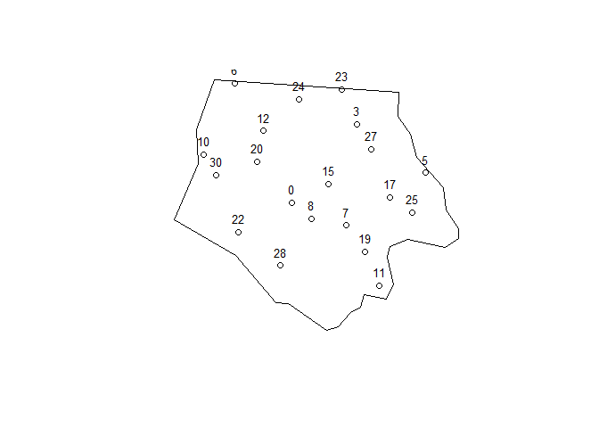
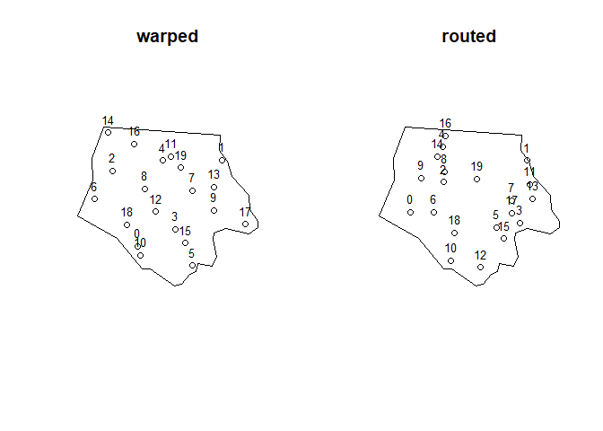
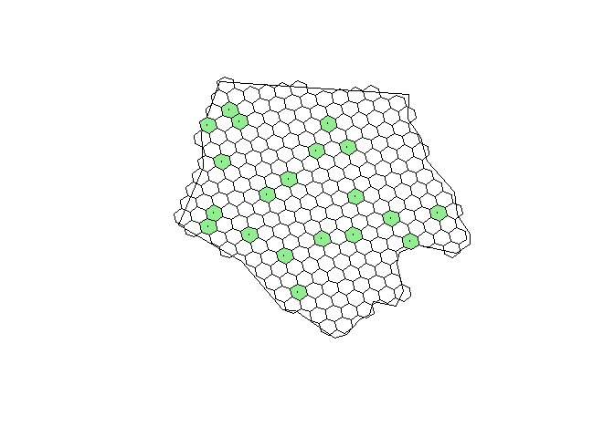

<!-- README.md is generated from README.Rmd. Please edit that file -->

<!-- badges: start -->

[](https://www.repostatus.org/#concept)
[](NA)
[](https://github.com/inbo/sbsampling/releases)

 


[](https://app.codecov.io/gh/inbo/sbsampling?branch=main)
[](https://extendr.rs/extendr/extendr_api/)
<!-- badges: end -->

# sbsampling: Sequence-Based Spatially Balanced Sampling on the Sphere <a href="https://inbo.github.io/sbsampling"></a>

[Van Calster, Hans](mailto:hans.vancalster%40inbo.be)[^1]

**keywords**: H3; GRTS; spatially balanced sampling; Sobol sequence

<!-- description: start -->

Implements spatially balanced sampling algorithms on the sphere using
sequence-based randomization. It offers both continuous sampling from
vector polygon geodata utilizing Owen-scrambled Sobol sequences, and
discrete spatial sampling via the H3 global grid system. Both approaches
operate natively on spherical geographic coordinates, eliminating the
need for map projections while ensuring spatially well-distributed
survey points. <!-- description: end -->

The `sbsampling` package implements sequence-based spatially balanced
sampling designs where the input sampling frame is in spherical
coordinates (typically a vector polygon or multi-polygon). The functions
either directly sample from the continuous spatial domain or leverage
the [H3](https://h3geo.org/) discrete global grid system for indexing
spatial data into a hexagonal grid.

For sampling from the [H3](https://h3geo.org/) discrete global grid
system, the package provides spatially balanced sampling via an
adaptation of the Generalized Random Tessellation Stratified (GRTS)
algorithm. For a given given random seed and H3 resolution, all sampling
units are deterministically sorted such that consecutively ordered
sampling units are spatially balanced samples for a given area on earth,
which makes it suitable for so-called master sampling applications.

For direct sampling from continuous spatial domains without
discretization, several implementations are provided. One, is a
modification of the balanced acceptance sampling (BAS) algorithm
(Robertson) whereby points are drawn from a 2-D Owen-scrambled Sobol
sequence and accepted when inside the sampling frame. Its domain of
applicability should be restricted to relatively compact spatial
domains. It is suitable for so-called master sampling applications. For
non-compact spatial domains, the package provides alternatives that
directly route or warp the 2-D Owen-scrambled Sobol sequence inside a
polygon without rejection sampling.

The implementations are written in [`Rust`](https://rust-lang.org/) and
wrapped into an R package using
[`rextendr`](https://extendr.rs/rextendr/). The package is developed
with the aid of large language models Google Gemini and Antropic Claude
Sonnet. R code is kept to a bare minimum and the package has zero R
dependencies. All algorithms are thoroughly tested, both with unit
testing and simulations. The implementation is lightweight,
cross-platform, fast and memory friendly.

## Installation

You can install the development version from
[GitHub](https://github.com/) with:

``` r
# install.packages("remotes")
remotes::install_git("https://github.com/inbo/sbsampling")
```

## Examples

### Sample from a continuous spatial domain

Let us extract Ashe county from the North Carolina state dataset that
ships with the `sf` package as an example spatial domain (sampling
frame) from which we want to draw a spatially balanced sample.

``` r
library(sbsampling)
nc_path <- system.file("shape/nc.shp", package = "sf")
ashe <- sf::st_read(
  nc_path,
  quiet = TRUE,
  query = "SELECT * FROM nc WHERE NAME='Ashe'"
)
ashe_wkb <- ashe |>
  sf::st_geometry() |>
  sf::st_as_binary()
ashe_wkb <- ashe_wkb[[1]]
```

Drawing a sample using the Sobol sequence-based balanced acceptance
sampling algorithm:

``` r
bas_sample <- sobol_sample(
  wkb = ashe_wkb, n = 20, seed = 456, algorithm = "acceptance"
)
bas_sample_sf <- sf::st_as_sf(bas_sample, coords = c("lon", "lat"), crs = 4326)
```

Visualizing the sample. Note that the `sobol_index` has gaps: points are
drawn in the bounding box and only those inside the polygon are
accepted.

``` r
plot(ashe$`_ogr_geometry_`)
plot(bas_sample_sf$geometry, add = TRUE)
coords <- sf::st_coordinates(bas_sample_sf)
text(
  x = coords[, 1], 
  y = coords[, 2], 
  labels = bas_sample_sf$rank, 
  pos = 3,
  cex = 0.8
)
```



Alternatively, we can use one of the Owen scrambled Sobol-sequence based
algorithms, which use exact area-warping or routing of the randomized
sequence inside the `wkb` geometry:

``` r
routed_sample <- sobol_sample(
  wkb = ashe_wkb, n = 20, seed = 789, algorithm = "routing"
)
warped_sample <- sobol_sample(
  wkb = ashe_wkb, n = 20, seed = 789, algorithm = "warp"
)
routed_sample_sf <- sf::st_as_sf(
  routed_sample, coords = c("lon", "lat"), crs = 4326
)
warped_sample_sf <- sf::st_as_sf(
  warped_sample, coords = c("lon", "lat"), crs = 4326
)
```

Visualizing the samples: note that the `rank` has no gaps because the
algorithms map the sequence directly inside the geometry’s exact area.

``` r
op <- par(mfrow = c(1,2), pty = "m")
plot(ashe$`_ogr_geometry_`)
plot(warped_sample_sf$geometry, add = TRUE)
coords <- sf::st_coordinates(warped_sample_sf)
text(
  x = coords[, 1], 
  y = coords[, 2], 
  labels = warped_sample_sf$rank, 
  pos = 3,
  cex = 0.8
)
title("warped")
plot(ashe$`_ogr_geometry_`)
plot(routed_sample_sf$geometry, add = TRUE)
coords <- sf::st_coordinates(routed_sample_sf)
text(
  x = coords[, 1], 
  y = coords[, 2], 
  labels = routed_sample_sf$rank, 
  pos = 3,
  cex = 0.8
)
title("routed")
```



``` r
par(op)
```

### Sample from the H3 discrete global grid system

We draw a spatially balanced sample with the aid of `grts_h3()` at
resolution 7 of the [H3
resolutions](https://h3geo.org/docs/core-library/restable/) system. This
corresponds to hexagonal areas of approximately 5.16 km². The `h3o`
package can be used to, among other things, obtain the hexagon centroid
or vertices.

``` r
h3_sample <- grts_h3(
  wkb = ashe_wkb,
  n = 20,
  resolution = 7,
  containment = "centroid",
  seed = 123,
  area_correction = FALSE
)
h3_sample$geom_points <- h3_sample$cell |>
  h3o::h3_from_strings() |>
  h3o::h3_to_points()
h3_sample$geom_hexagons <- h3_sample$cell |>
  h3o::h3_from_strings() |> 
  h3o::h3_to_vertexes() |>
  sf::st_cast("POLYGON")
```

We can visualise the selected spatially balanced sample and the H3
cells:

``` r
ashe_cells <- h3o::sfc_to_cells(
  ashe$`_ogr_geometry_`,
  resolution = 7,
  containment = "centroid"
)
ashe_hexagons <- h3o::h3_to_vertexes(ashe_cells[[1]]) |>
  sf::st_cast("POLYGON")
plot(ashe$`_ogr_geometry_`)
plot(ashe_hexagons, add = TRUE)
plot(h3_sample$geom_hexagons, col = "lightgreen", add = TRUE)
plot(h3_sample$geom_points, add = TRUE, cex = 0.3)
```



[^1]: author
